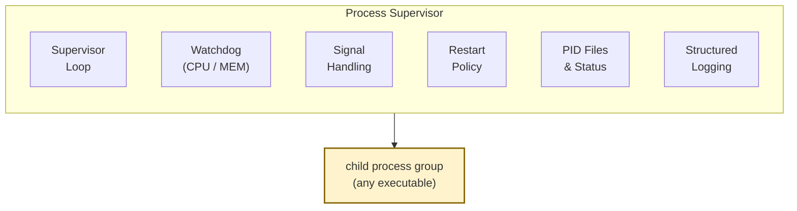
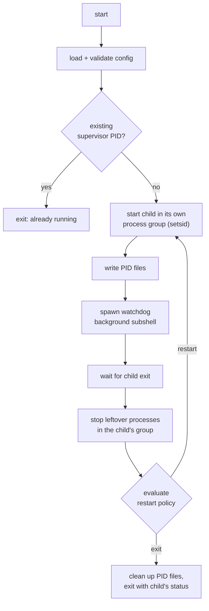
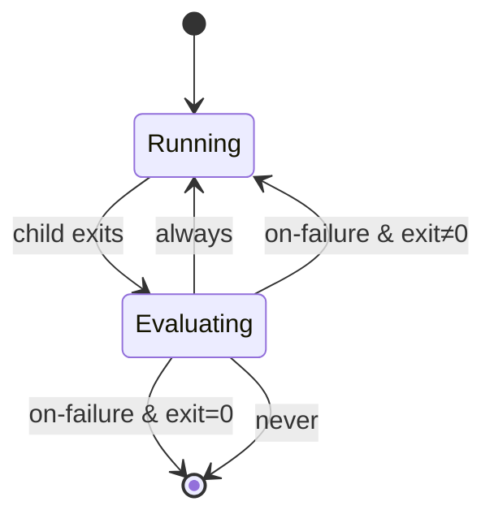
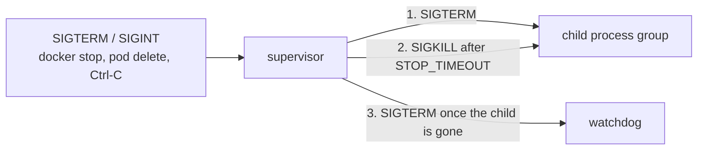

# 🛡️ Process Supervisor


A lightweight process supervisor written in Bash, containerized with Docker and deployed on Kubernetes. Handles PID 1 semantics, signal propagation, resource watchdogging and automatic restarts. Same set of problems real orchestrators solve, built from scratch.

> Built to understand what Kubernetes, systemd, and supervisord actually do when they manage a process. Bash because the constraints force you to confront PID 1 and signal forwarding directly instead of inheriting them from a runtime.

---

## Architecture



---

## Features

| Phase | Feature | Details |
|---|---|---|
| 1 | Dynamic proxy | Runs any command defined in config; supports arbitrary executables |
| 2 | Structured logging | Timestamped log lines to stdout + one log file per day, pruned after `LOG_RETENTION_DAYS` |
| 3 | Resource watchdog | CPU % and memory MB limits, summed over the child's process group; stops the child on breach |
| 4 | Restart policy | `always`, `on-failure`, or `never`; 1-second cooldown between restarts; exits with the child's status when it stops |
| 5 | Signal handling | `SIGTERM` / `SIGINT` forwarded to the child's whole process group; waits for a clean exit, `SIGKILL` after `STOP_TIMEOUT` |
| ★ | PID management | Supervisor and child PID files for external status queries |
| ★ | Status CLI | Supervisor + child status with resource usage via `ps`; exit code 0/1, used as the liveness probe |
| ★ | Config system | Plain `.conf` file; all knobs exposed as shell variables, validated at startup |
| ★ | Tests | Behaviour tests that run real supervisors against real processes |

---

## Project Structure

```
process-supervisor/
├── supervisor.sh          # Bash process supervisor
├── my_worker.py           # Example worker process
├── configs/
│   ├── example.conf       # Configuration used in the container
│   └── local.conf         # Same, with paths for running from the repo root
├── tests/
│   └── test_supervisor.sh # Behaviour tests
├── Dockerfile             # Container image definition
└── k8s/
    ├── deployment.yaml    # Kubernetes Deployment
    └── kustomization.yaml # Kustomize entrypoint
```

---

## Quick Start

**Option A: Local** (Linux, needs `procps` and `util-linux`; run from the repo root)
```bash
chmod +x supervisor.sh
./supervisor.sh start configs/local.conf
./supervisor.sh status configs/local.conf
./supervisor.sh tail configs/local.conf
./supervisor.sh stop configs/local.conf
```

**Option B: Docker**
```bash
docker build -t process-supervisor:local .
docker run --rm --name supervisor process-supervisor:local   # runs configs/example.conf
docker exec supervisor /app/supervisor.sh status configs/example.conf
docker stop -t 20 supervisor                                  # SIGTERM; Docker waits 20s (> STOP_TIMEOUT) before SIGKILL
```

**Option C: Kubernetes (kind)**
```bash
kind load docker-image process-supervisor:local --name kind
kubectl apply -k k8s
kubectl rollout restart deployment process-supervisor
```

**Check status:**
```bash
kubectl get pods
kubectl logs -l app=process-supervisor -f
```

---

## Tests

```bash
bash tests/test_supervisor.sh
```

Starts real supervisors against small Bash children and checks the restart policies, SIGTERM forwarding, SIGKILL escalation, process-group cleanup, both watchdog limits, config validation and the `stop`/`status` commands. Needs Linux with `procps` and `util-linux`; takes about 30 seconds.

---

## Configuration

```bash
NAME="demo_worker"
COMMAND="python /app/my_worker.py"
RESTART_POLICY="always"      # always | on-failure | never
MAX_CPU_PCT=90               # stop the child if its process group exceeds this CPU % (0 = disabled)
MAX_MEM_MB=200               # stop the child if its process group's RSS exceeds this (0 = disabled)
CHECK_INTERVAL=2             # watchdog poll interval in seconds
STOP_TIMEOUT=10              # seconds between SIGTERM and SIGKILL when stopping the child
LOG_DIR="/app/logs"
LOG_RETENTION_DAYS=7         # delete daily log files older than this (0 = keep all)
PID_DIR="/tmp/process-supervisor"
```

The config file is sourced as Bash, so treat it as code. Values are checked at startup: an unknown policy, a non-numeric limit, or a limit set without `ps` installed stops the supervisor with an error instead of being silently ignored.

---

## Docker

Slim base image plus `procps` (the watchdog needs `ps`), only the files the supervisor needs, a non-root user, and the supervisor as PID 1 through `ENTRYPOINT`:

```dockerfile
FROM python:3.12-slim
RUN apt-get update && apt-get install -y --no-install-recommends \
    procps \
 && rm -rf /var/lib/apt/lists/*
WORKDIR /app
COPY supervisor.sh my_worker.py ./
COPY configs/ ./configs/
RUN chmod +x /app/supervisor.sh \
 && groupadd --gid 10001 supervisor \
 && useradd --uid 10001 --gid 10001 --no-create-home --shell /usr/sbin/nologin supervisor \
 && mkdir -p /app/logs \
 && chown 10001:10001 /app/logs
USER 10001:10001
ENTRYPOINT ["/app/supervisor.sh"]
CMD ["start", "configs/example.conf"]
```

Arguments to `docker run` replace `CMD` and are passed to the `ENTRYPOINT`, so `docker run --rm process-supervisor:local start configs/example.conf` runs `supervisor.sh start configs/example.conf`, and any other config can be passed the same way.

---

## Kubernetes

The image's `ENTRYPOINT` is `supervisor.sh`, so the Deployment only sets `args`, which replace the image's `CMD`:

```yaml
args: ["start", "configs/example.conf"]
```

The pod also sets:
- **Resources:** the memory limit (256Mi) sits above `MAX_MEM_MB` (200), so the watchdog stops the worker cleanly before the kernel's OOM killer would.
- **Security context:** `runAsNonRoot`, no privilege escalation, all capabilities dropped.
- **Liveness probe:** runs `supervisor.sh status`, which exits non-zero when the supervisor or child is down.
- **`terminationGracePeriodSeconds: 30`:** longer than `STOP_TIMEOUT`, so the supervisor's own SIGTERM → SIGKILL sequence finishes before the kubelet kills the container.

---

## Architecture Notes

**Supervisor lifecycle**



**Restart policy state machine**



**Signal propagation**



Design notes:
- **`wait` runs in the main shell.** `wait` can only collect children of the current process. Inside `$(...)` it runs in a subshell, which isn't the child's parent, so it would return immediately instead of blocking.
- **The trap only sets a flag.** A trapped signal makes `wait` return early with status > 128 while the child is still running. The main loop then signals the child's process group and goes back to `wait` until the child has really exited, so the child's shutdown code finishes before PID 1 exits and the kernel kills everything left in the container.
- **The child gets its own process group.** For a simple command, `bash -c` execs it and `$!` is the worker itself. For something like `python worker.py | tee out.log`, `$!` is a bash wrapper; signalling only that PID would orphan the worker. `setsid` makes the group ID equal to the child's PID, and `kill -- -PID` reaches everything in it.

---

## Tradeoffs & Limitations

| Limitation | Why | What a production level supervisor does |
|---|---|---|
| 1-second restart cooldown | Simple to implement; fine for demo workloads | Exponential backoff (systemd, supervisord) to avoid crash loops eating CPU |
| CPU% from `ps` is a lifetime average, not instantaneous | Portable, no `/proc` parsing | Reads `/proc/<pid>/stat` deltas or uses cgroup accounting |
| Single child per supervisor | Keeps signal handling and PID tracking simple | Supervises many programs from one config (supervisord) |
| Child tracked by process group, not cgroup | Pure Bash, no root or cgroup setup | A child that calls `setsid` itself leaves the group; systemd and Kubernetes track processes by cgroup, which a process can't leave |
| Log files split by day and pruned by age, no size limit | `date` and `find` are enough for the demo | `logrotate` or structured log shippers with size + age policies |

---

## Troubleshooting

| Error | Cause | Fix |
|---|---|---|
| `ImagePullBackOff` | Image not loaded into kind cluster | `kind load docker-image process-supervisor:local` |
| `RunContainerError` | Missing system dependency in image | Add to `apt-get install` in Dockerfile |
| `exec: "start": executable file not found` | Image built without an `ENTRYPOINT`: `args` replaced `CMD`, so `start` became the command | Rebuild the image; it now sets `ENTRYPOINT ["/app/supervisor.sh"]` |
| `'ps' not found: the watchdog needs it` | `MAX_CPU_PCT` or `MAX_MEM_MB` is set but `procps` isn't installed | Install `procps`, or set both limits to 0 |
| `container has runAsNonRoot and image will run as root` | The pod is running an image built before the non-root `USER` | Rebuild the image and `kind load` it again |
| `Permission denied` | Script not executable in image | Add `RUN chmod +x /app/supervisor.sh` to Dockerfile |

---

## Author

**Dimitrios Dalaklidis**
📧 dalaklidesdemetres@gmail.com · [LinkedIn](https://www.linkedin.com/in/dimitrios-dalaklidis) · [GitHub](https://github.com/DimitriosDalaklidhs)
